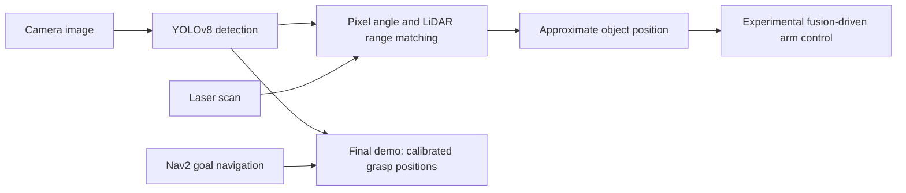
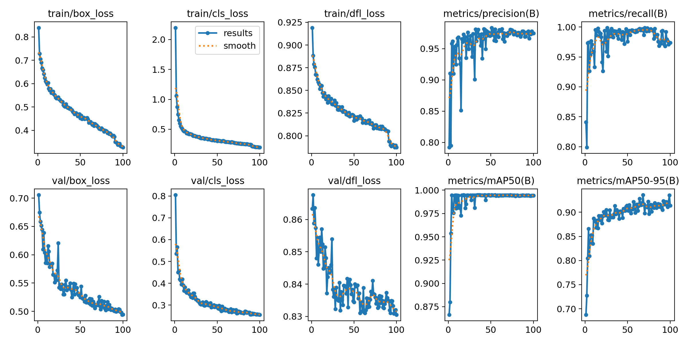

# ROS lab: Autonomous SLAM, Object Detection, and Manipulation with TurtleBot3

**Camera–LiDAR object localization in a TurtleBot3 navigation and manipulation pipeline.**

`ROS 2 Humble` · `Python` · `YOLOv8` · `OpenCV` · `Nav2` · `OpenMANIPULATOR-X`

This team lab project connects navigation, visual detection, approximate object localization, and pick-and-place control. This repository preserves the main-task source and training artifacts as a portfolio snapshot.

## My contribution

My focus was **object detection and camera–LiDAR localization**: processing camera images with YOLOv8, matching detections to LiDAR ranges, and publishing object information for the downstream robot pipeline. Navigation and manipulation are included as team integration context; they are not presented as my individual work. See [credits and provenance](CREDITS.md).

## How it works



| Component | Source | Role |
| :--- | :--- | :--- |
| Perception | [Detection node](turtlebot3_yolo_object_detection/turtlebot3_yolo_object_detection/turtlebot3_yolo_object_detection.py) | YOLO detections, range matching, object messages |
| Navigation | [Nav2 controller](my_nav2_controller/my_nav2_controller/nav_script.py) | Goal selection and intermediate waypoint |
| Final arm controller | [Calibrated grasping](arm_controller_pkg/arm_controller_pkg/arm_commander.py) | Repeatable pick/place in the lab setup |
| Experimental controller | [Fusion-driven grasping](sensorfusion_arm_controller_pkg/sensorfusion_arm_controller_pkg/sensorfusion_arm_commander.py) | Integration experiment, not the final deployed controller |

## Engineering findings

The fusion method uses an assumed camera field of view, a nearby LiDAR range window, and a fixed height. The current coordinate conversion adds TF translation without applying full rotation. It is an approximate localization method, not a calibrated general-purpose 3D reconstruction system.

In the original lab deployment, localization noise and timing made fusion-driven grasping unreliable. The final demonstration used calibrated grasp positions. Keeping both implementations documents that tradeoff rather than hiding the experimental limitation.

## Run in the original lab environment

Requires a configured ROS 2 Humble workspace, TurtleBot3 Waffle Pi, camera/LiDAR topics, OpenMANIPULATOR-X, Nav2, MoveIt, and the Python perception dependencies (`ultralytics`, OpenCV, `cv_bridge`, TF2).

```bash
mkdir -p ~/ros2_lab_ws/src
cd ~/ros2_lab_ws/src
git clone https://github.com/Kylie08ky/ros2-perception-manipulation.git
cd ~/ros2_lab_ws
colcon build --symlink-install
source install/setup.bash

# After hardware and camera bringup:
ros2 launch turtlebot3_yolo_object_detection turtlebot3_yolo_object_detection.launch.py \
  model_path:=$HOME/ros2_lab_ws/src/ros2-perception-manipulation/train/weights/best.pt
```

Follow the [lab setup and operating sequence](docs/LAB_NOTES.md) for navigation and arm control. Map coordinates, sensor assumptions, and grasp poses are specific to the original setup.

## Included evidence

- [Sensor-fusion diagram](turtlebot3_yolo_object_detection/sensor_fusion_pipeline.png)
- [Training curves](train/results.png), [training log](train/results.csv), and [validation predictions](train/val_batch0_pred.jpg)
- Trained checkpoints in `train/weights/`; the full training dataset is not included.



Publication checks cover source syntax and file integrity. Hardware execution and training have not been repeated for this upload.

## Attribution and reuse

Original Group 5 and upstream author metadata are retained. The TurtleBot3 detection package includes its [Apache-2.0 license](turtlebot3_yolo_object_detection/LICENSE). Other packages contain incomplete or differing license declarations; this repository does not assign a new blanket license. See [CREDITS.md](CREDITS.md).
