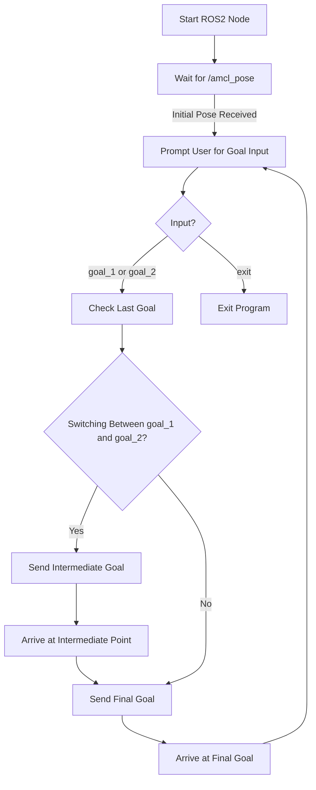
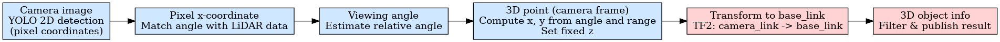
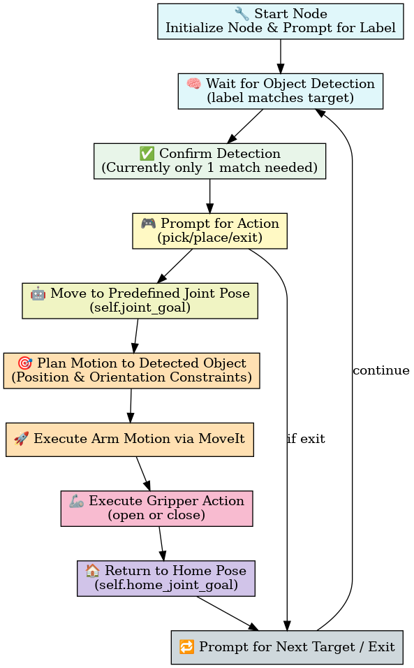

# Main Task 2: Autonomous SLAM, Object Detection, and Manipulation with TurtleBot3

## **Objective**

Build a complete robotic pipeline using TurtleBot3 Waffe Pi with OpenManipulator X andROS2 Humble. The robot should perform autonomous SLAM-based navigation, detect and localize an object using sensor fusion (camera and LiDAR), pick it using the manipulator, and place it in a predefned location.

This repository implements a complete system for autonomous navigation, object detection, sensor fusion, and manipulation using TurtleBot3 and OpenManipulator X in ROS 2. It includes:

- SLAM-based navigation and map creation
- Navigation Script with Nav2
- YOLOv8 object detection method
- Sensor fusion pipline
- Manipulator Planning and Control
- How to run, the total pipline

---

## 🗺️ SLAM-based navigation and map creation
1.Bring up the TurtleBot3 Manipulation Actual

**[TurtleBot3 SBC]**
```bash
ros2 launch turtlebot3_manipulation_bringup hardware.launch.py
```

2.Launch the servo server node.

**[Remote PC]**
```bash
ros2 launch turtlebot3_manipulation_moveit_config servo.launch.py
```
3.Launch teleop node using the following command.

**[Remote PC]**
```bash
ros2 run turtlebot3_manipulation_teleop turtlebot3_manipulation_teleop
```
4.Use **O**, **K**, **L**, **;** keys to drive the TurtleBot3 platform.

5.Save the Map: Open a terminal on Remote PC and using the following command

**[Remote PC]**
```bash
ros2 run nav2_map_server map_saver_cli -f ~/map
```
6.Saving generates in the root directory
map.yaml: contains the map meta information.
map.pgm: grayscale map, indicating that it occupies the raster map 
(The author has uploaded the project map to the folder [**map**](../map))


---
## 📍 Navigation Script with Nav2 (`nav_script.py`)

This script provides a simple terminal-based interface for navigating a mobile robot (e.g., TurtleBot3) to predefined goal positions using the ROS2 `nav2` stack. It allows the user to input goal commands via terminal and ensures smooth transition between navigation targets by incorporating an intermediate waypoint during goal switching.For specific code details, check out the [**nav_script.py**](../my_nav2_controller/my_nav2_controller/nav_script.py),  See how to run for [ **🚀 How to run**](#-how-to-run) it in this project.



### Features

- **ROS2 Nav2 Integration**: Utilizes the `NavigateToPose` action interface for goal execution.
- **Predefined Goal Management**: Supports two preset goals (`goal_1`, `goal_2`) and one intermediate point.
- **Intelligent Transitioning**: When switching between goals, the robot first travels to an intermediate waypoint to ensure smooth path planning.
- **AMCL Pose Readiness**: Navigation is enabled only after the robot’s pose is initialized via AMCL (`/amcl_pose`).
- **Terminal Interaction**: Users are prompted in terminal to choose a goal or exit.

### Execution Logic

1. **Initialization**:
   - The ROS2 node `SimpleNav` is initialized.
   - Subscribes to `/amcl_pose` to wait for initial pose estimation.
   - Initializes an action client for `/navigate_to_pose`.

2. **Waiting for Localization**:
   - The script remains idle until the first AMCL pose is received.
   - Once localization is confirmed, a new thread starts prompting the user for input.

3. **Goal Input Handling**:
   - The user inputs either `goal_1`, `goal_2`, or `exit`.
   - If switching between `goal_1` and `goal_2`, the robot first navigates to an **intermediate waypoint** to ensure a stable transition.

4. **Sending Goals**:
   - Goals are sent asynchronously using `send_goal_async`.
   - The script waits for goal acceptance and logs the navigation status.

5. **Post-Goal Behavior**:
   - After reaching the intermediate point, the robot proceeds to the final goal.
   - Once the final goal is reached, the system logs completion and prompts the user for the next destination.

### Goal Configuration

Defined in the `GOALS` dictionary:

```python
GOALS = {
    "goal_1": {
        "position": (x1, y1, z1),
        "orientation": (qx1, qy1, qz1, qw1)
    },
    "goal_2": {
        "position": (x2, y2, z2),
        "orientation": (qx2, qy2, qz2, qw2)
    }
}
```

Intermediate point:
```python
INTERMEDIATE_POINT = {
    "position": (ix, iy, iz),
    "orientation": (0.0, 0.0, 0.0, 1.0)
}

```
These coordinates should be adjusted to match your map setup in either simulation or real environment.

---

## 🧠 YOLOv8 object detection method

This project uses a YOLO-based object detection pipeline integrated with ROS 2. Below is an overview of the detection process:

### Detection Model
- **Model**: YOLOv8 (via `ultralytics` library)
- **Format**: `.pt` file (`best.pt`) loaded at runtime
- **Input**: Subscribed from `/image_raw` topic
- **Output**: Bounding boxes, class labels, confidence scores

### Image Processing
- ROS image messages are converted to OpenCV format using `cv_bridge`
- YOLO detects objects in the image
- For each detection:
  - Pixel location of object center is computed
  - Class name is retrieved from YOLO's output
  - Annotated image with bounding boxes is published

### Published Topics
- `/detected_object_pixel` (`PointStamped`): Pixel coordinates of detection
- `/detected_object_class` (`String`): Object class name
- `/camera/detections/compressed` (`CompressedImage`): Image with bounding boxes
- `/detected_object_info` (`String`): Summary string like `bottle at (u=300.2, v=245.6)`
- `/detected_object_3d` (`String`): 3D position and class of the object after fusing image and lidar data`

### Call the Node

We have placed the Launch files as well as the trained model parameters in these two folders:[**turtlebot3_yolo_object_detection**](../turtlebot3_yolo_object_detection),       [**train**](../train)

   **1.Run v4l2_camera_node**

   **[TurtleBot3 SBC]**
   ```bash
   ros2 run v4l2_camera v4l2_camera_node
   ```
   **2.Run the Detection Node**

   You can pass the path to your best.pt model file as a parameter at runtime. Replace the model_path with the path to your custom-trained .pt file.

   **[Remote PC]**
   ```bash
   ros2 launch turtlebot3_yolo_object_detection turtlebot3_yolo_object_detection.launch.py model_path:=<path_to_best.pt>
   ```
### Visualize the Detection Results

Open rqt and select the /camera/detections/compressed topic to view the camera feed with detection results. The detection node publishes the result as annotated image to the /camera/detections/compressed topic using OpenCV.

   **[Remote PC]**
   ```bash
   rqt
   ```
### More details can search 
[**YOLO Object Detection**](https://emanual.robotis.com/docs/en/platform/turtlebot3/basic_examples/#yolo-object-detection)

---

## 🤖 Sensor Fusion Pipeline (Camera + LiDAR)

This pipeline fuses 2D object detection results from YOLO (based on camera images) with 3D distance information from LiDAR, resulting in approximate 3D object localization in the robot base frame.
For specific code details, check out the [**turtlebot3_yolo_object_detection.py**](../turtlebot3_yolo_object_detection/turtlebot3_yolo_object_detection/turtlebot3_yolo_object_detection.py)

### Fusion Process Overview

- Camera image → YOLO → 2D detection (pixel coordinates)
- Pixel x-coordinate → FOV mapping → Estimate viewing angle
- Match angle with LiDAR range data → Get distance
- Convert to 3D point in camera frame
- Transform 3D point to `base_link` using TF2
- Filter and publish 3D object info


### **Detailed Steps**

**1. 2D Detection (Image)**

- YOLO detects objects in the incoming image (/image_raw)
- For each object:
    - Extract class name
    - Compute center pixel (x_center, y_center)
    - Publish results via:
      - /detected_object_pixel (PointStamped)
      - /detected_object_class (String)
      - /detected_object_info (String)
   
**2. Estimate Viewing Angle**

- The camera horizontal FOV is assumed to be 60 degrees

- Convert pixel x to relative angle:
    
```bash
angle_per_pixel = fov_deg / image_width
relative_angle_deg = (x_center - image_width / 2) * angle_per_pixel
```
- Convert angle to radians for LiDAR usage

**3. Find Corresponding LiDAR Range**

- Match estimated angle to LiDAR index:

```bash
index_center = (theta_rad - scan.angle_min) / scan.angle_increment
```
- Search ±3 indices around the center for valid range values
- Find the **closest** valid range (ignore NaNs, too-far values)

**4. Compute Camera Frame Coordinates**

- Compute `(x, y)` in the camera frame using range and angle:

```bash
x_cam = range * cos(theta) - offset_x
y_cam = range * sin(theta) - offset_y
z_cam = 0.05  # Assume fixed height from camera
```
- The offset accounts for the displacement between LiDAR and camera

**5. Transform to Robot Base Frame**

- Use `tf2_ros` to look up transform from `camera_link` to `base_link`

- Apply the transform to convert the point into robot coordinates

**6. Filter & Publish 3D Results**

- Filter out objects with `x > 1.0 `(likely too far or noisy)

- Publish fused result as string to:

```bash
/detected_object_3d (std_msgs/String)
```
Example:

```bash
bottle: x=0.72, y=-0.12, z=0.05
```
### Limitations & Assumptions

- Assumes 60° horizontal field of view (FOV) for camera
- Hard-coded camera-to-lidar offsets
- Fixed camera height
- Only closest object along direction is considered
- Objects beyond 1 meter in x-direction are ignored

---

## 🦾 Manipulator Planning and Control
This node provides autonomous manipulation capabilities for a robotic arm (e.g., OpenManipulator X) using ROS 2 and MoveIt. It performs pick-and-place operations based on 3D object detection results and user input.
For specific code details, check out the [**sensorfusion_arm_commander.py**](../sensorfusion_arm_controller_pkg/sensorfusion_arm_controller_pkg/sensorfusion_arm_commander.py)

### Workflow Overview

1. **User Label Input**
   - Prompts user to enter a target label (e.g., "white cylinder horizontal").
   - Starts monitoring `/detected_object_3d` for matching labels.

2. **Detection Confirmation**
   - Once the target label is detected even once (current implementation), the system sets `self.confirmed = True`.
   - Originally a 10-frame deque was intended for stability filtering, but in the current version, only one detection is required.
   - Then, the system prompts the user to select an action: `pick`, `place`, or `exit`.

3. **Motion Planning via Constraints**
   - Uses detected 3D coordinates to build a:
     - **PositionConstraint** centered on the object (with 2cm vertical offset).
     - **OrientationConstraint** to maintain gripper pose.
   - Constructs and sends a `MoveGroup` action goal for the arm.
   - Planning is done in the `base_link` frame directly, no TF conversion required.

4. **Arm Movement Execution**
   - Before executing grasping, the robot moves to a predefined joint-space pose (`self.joint_goal`) to ensure safe starting position.
   - After that, dynamic planning to the detected object is triggered.

5. **Gripper Control**
   - Gripper is controlled via joint-space constraint (target width).
   - Width = `0.019 m` for pick, `-0.010 m` for place.

6. **Return to Home**
   - After pick/place is complete, the arm returns to a predefined home joint pose (`self.home_joint_goal`).
   - User is prompted again for another action.


---

### Implementation Highlights

| Component            | Description                                                                 |
|----------------------|-----------------------------------------------------------------------------|
| `MoveGroup` Client   | Sends motion goals to arm and gripper control groups via `move_action`      |
| IK Solver (optional) | `compute_ik()` function queries `/compute_ik` for inverse kinematics         |
| Label Matching       | `self.confirmed` is set after the first matching label (no deque logic used) |
| Constraints          | Position + orientation constraints for precise motion                       |
| Gripper Joint Goal   | Controlled via `JointConstraint` targeting `gripper_left_joint`              |
| Async Execution      | Uses callback chaining for goal result handling                             |

---


### Call node

**[Remote PC]**

```bash
ros2 run your_package sensorfusion_arm_commander.py
```

You will be prompted:
```
Enter target label (e.g., 'white cylinder horizontal'):
Please enter the action (pick/place/exit):
```

After successful detection and motion, the arm returns to the home position and waits for your next command.

---

### ⚠️ Stability Notice and Alternative Implementation

> While the `sensorfusion_arm_commander.py` script demonstrates the intended logic for autonomous manipulation using 3D object detection and MoveIt planning, **it was not used in the final project deployment** due to stability and precision limitations.

- **Stability Issues**: The real-time performance of the script proved unreliable, particularly under noisy detection conditions or timing delays in ROS communication.
- **Sensor Fusion Accuracy**: The 3D object position estimates derived from camera-LiDAR fusion were not consistently accurate enough for precise pick-and-place operations, leading to grasping failures.
- **Final Implementation**: To ensure robust behavior, we developed and used an alternative script ([arm_commander.py](../arm_controller_pkg/arm_controller_pkg/arm_commander.py)) with simplified logic and hardcoded grasp positions based on prior calibration.

> This decision was made to prioritize reliability and repeatability in a controlled demonstration environment.


---

## 🚀 How to run

**NOTE**：To use the OpenMANIPULATOR-X you need to finish following configuration prerequisites: Please go to the [Turtlebot3](https://emanual.robotis.com/docs/en/platform/turtlebot3/manipulation/#operate-the-actual-openmanipulator) to complete the basic starter configuration, and refer to **7.1-7.5** to install the relevant dependencies and configurations

Please be aware that the actual hardware operation requires [Bringup](https://emanual.robotis.com/docs/en/platform/turtlebot3/manipulation/#bringup) from the TurtleBot3 SBC.

### **Step 1：Bring up the TurtleBot3 Manipulation using the following command.**

**[TurtleBot3 SBC]**
```bash
ros2 launch turtlebot3_manipulation_bringup hardware.launch.py
```

### **Step 2: Run v4l2_camera_node**

**[TurtleBot3 SBC]**
```bash
ros2 run v4l2_camera v4l2_camera_node
```

### **Step 3: Run the Detection Node**

You can pass the path to your best.pt model file as a parameter at runtime. Replace the model_path with the path to your custom-trained .pt file.

**[Remote PC]**
```bash
ros2 launch turtlebot3_yolo_object_detection turtlebot3_yolo_object_detection.launch.py model_path:=<path_to_best.pt>
```

### **Step 4: Run Navigation Nodes**

1.Open a terminal on Remote PC.

2.Launch the navigation file using the following command. 

**[Remote PC]**
```bash
ros2 launch turtlebot3_manipulation_navigation2 navigation2.launch.py map_yaml_file:=$HOME/map.yaml
```

### **Step 5: Run nav_script.py**

1.Open a terminal on Remote PC.

2.Launch the script using the following command. 


**[Remote PC]**
```bash
ros2 run my_nav2_controller nav_script
```
3.set 2D Pose Estimate in Rviz,which was opend in step 4

4.Enter "goal_1" or "goal_2" in this terminal（You can also open the script to customize these two points）

### **Step 6: Run MoveIt Nodes**

Enter the command below to launch the MoveIt on RViz.

**[Remote PC]**
```bash
ros2 launch turtlebot3_manipulation_moveit_config servo.launch.py
```

### **Step 7: Run arm_commander.py**

1.Open a terminal on Remote PC.

2.Launch the arm_commander.py using the following command. 

**[Remote PC]**
```bash
ros2 run arm_controller_pkg arm_commander 
```
3.After running, the terminal will prompt for the label of the target to be picked, for example (white cylinder horizontal)

4.After entering the label and waiting for the target to be detected, the terminal will prompt for a **pick** or **place** operation.

5.After performing the pick operation return to the terminal in step 5 that is executing nav_script.py and enter another goal, (e.g. goal_2)

6.The cart arrives at its destination and returns to this terminal, which is executing arm_commander.py, and enters **place**, and the robotic arm drops the target object. 

7.At this point, the entire project has been implemented.
